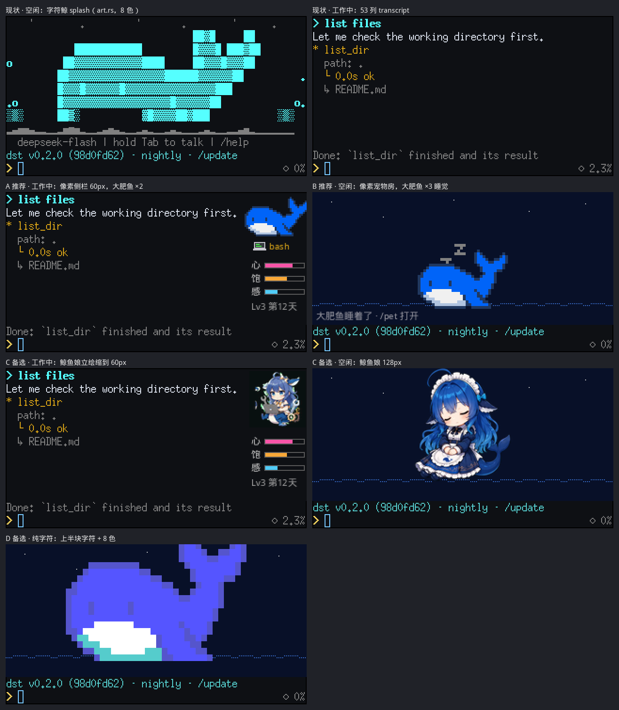

# Cardputer Zero DSH 桌宠「大肥鱼」开发设计（交接给实现阶段）

状态：设计稿，供后续实现与验收使用。本文只描述方案；除 `tools/sim/pet_mockup.py`
（离屏 mockup 工具）和 `docs/pet/layout-mockups.png`（预览图）外，本分支不改任何产品代码。

阅读顺序：§0 结论 → §7 待确认问题 → §5 分阶段任务。§1–§4 是依据与细节。

---

## 0. 结论（TL;DR）

- **载体**：继续用本仓 `dst`（零依赖 Rust、fbterm 上的 53×12 TUI）。它已经移植了
  DSH 的 turn/step/tool 事件流，宠物所需信号全部在进程内（`harness::Ev`），无需抓 DOM，
  也不需要 Electron/Tauri/浏览器——这些在 512 MB 的 CM0 上都不现实。
- **参考仓的复用方式**：`dsh-whale-musume` 是 DSH 桌面端/旧 Web 的**纯前端 DOM 注入插件**
  （JS + CSS + 92 张 512×512 webp），表现层与 DOM 选择器**不可移植**；可移植的是它的
  **纯函数状态机与养成规则**（`assets/whale-moe-core.js`）：成长数值、45 个成就 ID、
  每日任务/签到规则、`WM1-` 迁移码与 JSON 存档格式。用 Rust 重写这些规则，保持 ID 与格式兼容。
- **宠物形态（推荐，待用户确认）**：**像素「大肥鱼」鲸鱼本体**，用 dsh-TUI / dsh-ui-whale
  的 40×25 手绘像素鲸（22 帧：眨眼、胸鳍、摆尾、喷水、爱心、睡觉 Z）。这正是 `dst`
  启动动画 `src/art.rs` 字符鲸的原始来源，品牌一致、许可清晰（BSD-3/MIT）、在 320×170
  上 ×2/×3 缩放清晰可辨。鲸鱼娘立绘缩到 60px 后表情与道具基本不可辨（见预览图 C），
  只作为后续可选皮肤。
- **渲染方式（推荐）**：**混合渲染**——文字仍由 fbterm 画，宠物用像素直接写入面板
  framebuffer 的一块“保留单元格区域”。仓库已有先例：WeChat 登录二维码就是这样直写
  framebuffer 的（`src/login.rs::draw_qr_fb`，`Scr::qr_blit`）。非面板终端（SSH、tmux、
  模拟器、无 framebuffer）自动回落到**纯字符**表现（现有字符鲸 + 状态徽标），保证零回归。
- **布局（推荐）**：
  - 对话/工作中：右侧 **10 列 × 10 行 = 60×140 px 像素侧栏（dock）**，大肥鱼 ×2（58×42 px）
    + 工具道具图标 + 心情/饱食/好感条；正文折行宽度 53→43 列（-19%）。可配置关闭。
  - 空闲：用**像素宠物房**替代字符 splash（行 0–9 共 320×140 px，大肥鱼 ×3），状态行与输入行保持文本。
- **首版范围**：事件驱动的动画状态机（思考/流式/按工具类别工作/成功喷水/失败/压缩/睡觉）、
  摸头/投喂/夸夸、心情/饱食/好感/等级/签到/陪伴天数、DSH 用量类与互动类成就子集、
  本地存档、`WM1` 迁移码与 JSON 存档的**导入与导出**。小游戏、天气、余额、节日换装、
  530 条台词、TTS、关键词感知不在首版。

预览（真实 dst 截图 + 候选宠物层，320×170 原生像素，×2 最近邻放大）：



---

## 1. 代码事实与依据

### 1.1 检查的仓库与 commit

| 仓库 | 角色 | commit | 许可证 | 备注 |
| --- | --- | --- | --- | --- |
| `Ocean-lhy/deepseek-harness-tui-cardputer` | 主仓（实现载体） | `1059561f793d206f9963e9f7b28a2d5792007f5f`（main，`release: bump to 0.2.0 …`） | GPL-3.0 | fork 自 `MarsTechHAN/deepseek-harness-tui-cardputer`；二进制名 `dst` |
| `Ocean-lhy/dsh-whale-musume` | 参考仓（只读） | `6e77caed46da3629921b6a4b2b7dacb0838b36b6`（main，最后功能提交 `3928dfa` v2.5.3） | MIT © Sutera-Diffusus | fork 自 `Sutera-Diffusus/dsh-whale-musume`；公开可读，未用任何凭据 |
| `ccch1mneyyy/dsh-TUI` | 像素鲸帧数据（`src/components/whaleFrames.ts`） | `55b33aea793f34e3cab48a5579f3e7595031e72e` | MIT © chimney | `docs/SPLASH-STORYBOARD.md` 记录 `art.rs` 字符鲸来源于此 |
| `lhh010/dsh-ui-whale` | 像素鲸原画与事件→动画规则 | `6fa0bd583a52a1049f302be299466c41872136d4` | BSD-3-Clause © lhh010 | DSH Web 标题栏像素鲸插件；22 帧 25×40、6 色调色板 |
| `deepseek-ai/deepseek-harness` | DSH 本体 | 只确认存在（MIT），未读源码 | MIT | `dst` 的 loop/goal/compaction 移植对象 |

### 1.2 「DSH」的确切含义

DSH = **DeepSeek Harness**（`deepseek-ai/deepseek-harness`），DeepSeek 的 agent harness，
有 Web profile（`dsh web`，旧版 0.1.x）和 Electron 桌面端（0.2.x，origin `dsh-app://app`）。

- 参考仓是 DSH 的**插件**：`package.json` 中 `dsh.bundle.patch = cordis.patch.yml`、
  `dsh.client.platform = "web"`；`lib/index.js` 在宿主注册只读静态路由
  `/api/dsh-whale-musume/assets`，`lib/client.js` 往页面注入 CSS/JS 与设置面板。
  工作状态来自**抓取 DSH 前端 DOM**：`[data-tool]` + `data-state=running|preparing`、
  `[data-chat-running]`、`[data-terminal]` 等（README「桌面端适配了哪些契约差异」与
  `assets/dsh-whale-moe.js::toolVisible/collectSignals`）。工具细分是对工具卡**文本做关键词匹配**
  （`TOOL_POSES`，`dsh-whale-moe.js:2375`），识别不了回落通用姿态。
- 主仓 `dst` **不是** DSH 客户端，而是把 DSH 的 agent loop 用 Rust 重写到设备上
  （README「ported from the DeepSeek Harness (DSH)」，`docs/ARCHITECTURE.md`）。
  DSH 事件在 `dst` 中是进程内枚举 `harness::Ev`（`src/harness.rs:112`）：
  `TurnStart, StepStart, Delta, Thinking{secs,chars}, ThinkingDelta, ToolTick{name,secs},
  ThinkingDone, Assistant, ToolCall{id,name,title,args}, ToolResult{id,name,content,is_error},
  StateReport, Context, Compacting, CompactingDone{ok}, Artifact, Note, Info, Hint,
  StepEnd, TurnEnd{steps}`。TUI 在 `impl harness::Ui for TermUi::on`（`src/main.rs:3542`）消费它们。
  登录走 DSH 桌面客户端同款九步 WeChat 流程（`src/dsh_login.rs`），token 存 `api.dsh_token`。
- 结论：宠物在 `dst` 中直接订阅 `Ev`，信号**精确且确定**（工具名就是 `ToolCall.name`），
  比参考仓的 DOM/文本猜测更可靠；**不需要也不应该**依赖 DSH 桌面端的 DOM 契约。

### 1.3 主仓架构要点（与宠物相关）

| 事实 | 依据 |
| --- | --- |
| 零第三方 crate 是设计约束（JSON/YAML/QR/base64 全手写，HTTP 走 `curl`） | `Cargo.toml` `[dependencies]` 为空；`docs/ARCHITECTURE.md` 不变式 1 |
| 设备：320×170 面板、53×12 单元格、单核预算、512 MB（可见约 446 MB） | `docs/ARCHITECTURE.md` 不变式 4、§Bounded memory |
| UI 线程拥有终端；耗时工作在线程里经 channel 回报 | `docs/ARCHITECTURE.md` §Process and threads |
| 每次 `draw()` 全量重绘 12 行 ANSI（`\x1b[H` + 每行 `\x1b[K\r\n`），8 色 SGR | `src/main.rs:601-929`；`K_*` 颜色常量 `src/main.rs:199-208` |
| transcript 在 `push()` 时按 `self.cols` 折行（不是绘制时） | `src/main.rs:575-581`（`wrap_into(..., self.cols.min(PANEL_COLS))`） |
| 空闲 key-poll 周期 300 ms（`stty time 3`），启动动画按 tick 驱动 | `src/main.rs:1565` `read_key_timeout`；`src/art.rs` `TICK_MS=300`；`Scr::anim_tick` `src/main.rs:555` |
| 启动动画：18 帧字符鲸，确定性调度，有单测 | `src/art.rs`（`FRAMES`、`Splash`、`tests`） |
| 已有像素直写先例：QR 码 RGB565 写入 `/dev/fb_panel`，并用 `qr_blit` 抑制文本重绘 | `src/login.rs:454-693`；`src/main.rs:614-617, 4626-4628` |
| 面板 framebuffer 路径**不一致**：`login.rs` 写 `/dev/fb_panel`，`hwinfo.rs` 与 hardware-info skill 写 `/dev/fb_lcd` | `src/login.rs:526,678`；`src/hwinfo.rs:412-415`；`assets/skills/hardware-info/SKILL.md:87-90` |
| hardware-info skill 现在写着“Never open `/dev/fb*` … from inside dst - the panel belongs to fbterm” | `assets/skills/hardware-info/SKILL.md:168` |
| creator 模式非目标包含 “grabbing the framebuffer”（针对用户 app） | `docs/CREATOR.md:97-99` |
| 6 种 UI 语言，缺 key 单测失败 | README §Internationalisation；`src/i18n.rs` |
| 状态目录 `~/.dst`，配置 `~/.dst/config.yml`（mode 600），会话/检查点有界、原子写 | `docs/ARCHITECTURE.md` §Sessions；`src/config.rs` |
| 多实例：每个 pty 一个 dst，共享 `~/.dst` | `docs/ARCHITECTURE.md` §Multiple instances |
| 系统提示词与历史前缀缓存友好（逐字回放） | README §Agent loop |
| 测试：`cargo test`（126 个）；`tools/sim` 用 pty + pyte 渲染 320×170 PNG，105 个场景 + 内存检查 | `tools/sim/README.md`；`.github/workflows/ci.yml` |

本次基线实测（x86_64 云端，rustc 1.83）：`cargo build --release` 成功；`cargo test -- --test-threads=1`
**126/126 通过**；默认并行时 `checkpoint::tests::same_second_checkpoints_do_not_overwrite`
偶发失败（共享状态竞争，既有问题，与本设计无关，实现阶段不要误判为回归）。

**模拟器陷阱（必须写进实现说明）**：release 构建启动时会后台检查更新并**原地替换二进制**
（`src/update.rs`）。本次在模拟器里跑 release 版时，`target/release/dst` 被替换成了线上 nightly。
所有预览/场景运行必须带 `--env DST_NO_UPDATE_CHECK=1`，或使用 debug 构建（`run_scenarios.py` 默认 debug）。

### 1.4 参考仓现状（实测）

| 项 | 事实 | 依据 |
| --- | --- | --- |
| 形态 | DSH 插件，仅 Windows 桌面端（Electron）与旧 Web 浏览器 | README §兼容性 |
| 表现层 | `assets/dsh-whale-moe.js`（3742 行，DOM/CSS 动画/拖拽/菜单/设置面板） | 文件本身 |
| 状态机 | `assets/whale-moe-core.js`（2448 行，纯函数、无 DOM） | 文件头注释 |
| 立绘 | `assets/generated/` 92 张 webp，全部 512×512 RGBA，共 13 MB | 本地 PIL 统计 |
| 立绘来源 | **AI 生成**：`scripts/gen-assets.py` 调第三方接口 `gpt-image-2`（`DSH_IMAGE_API` 默认 `free.quanthatch.com`），再绿幕抠图切片 | `scripts/gen-assets.py:1-20`、`scripts/build-assets.py` |
| 成就 | 正好 45 个（`ACHIEVEMENTS`） | `whale-moe-core.js:651-697` |
| 小游戏 | 戳泡泡（4×4，30 s）、接点心、鲸鱼翻翻乐（4×4 记忆，60 s），共享每日 3 局奖励上限 | `whale-moe-core.js` `GAME/CATCH/MEMORY` |
| 工作姿态 | `computeState` 优先级 error > tool > thinking > success(2 s) > curious(6 s) > waiting > afk(180 s)/idle；工具细分靠关键词 | `whale-moe-core.js:205-247`；`dsh-whale-moe.js:2375-2420` |
| 存档 | 宿主 `localStorage` 的 `whale-moe:*` 键；迁移 schema `dsh-whale-musume/save` v1；迁移码 `WM1-<FNV-1a 8hex>-<base64url(JSON)>`，只带核心键；坏码不改存档 | `whale-moe-core.js:776-1100` |
| 隐私 | 默认零外部请求；天气 Key、经纬度、悬浮位置**不迁移** | README §数据与隐私；`PORTABLE.KEYS` |
| 测试 | `npm test` 本地实测 **209/209 通过**（README 写 203，以实测为准） | `node --test test/*test.mjs` |

### 1.5 Cardputer Zero 实际约束（不是 ESP32 Cardputer）

来源：`assets/skills/hardware-info/SKILL.md`（仓库内随附的设备笔记）、`docs/ARCHITECTURE.md`、`tools/sim/README.md`。

- SoM：Raspberry Pi **CM0**（RP3A0，4×Cortex-A53 @1.0 GHz，aarch64），512 MB，Debian 13 trixie，kernel 6.18。
  **不是** ESP32-S3 Cardputer/ADV（240×135、UIFlow/M5Burner 完全不适用）。
- 屏幕：ST7789v3 **320×170 RGB565 SPI LCD**，DRM `panel-mipi-dbi`，fbdev 节点 udev 名 `/dev/fb_lcd`（skill 记载）；
  fb0 可能是 HDMI。GPU VideoCore IV 对 dst/fbterm 无用（软件渲染）。
- 文字：fbterm 在 tty1，6×13 字形、6×14 节距、1 px 边距 → 53×12 单元格，使用 318×168 px；**8 色**，无 emoji/宽字形（CJK 依赖 fbterm 字体）。
- 输入：TCA8418 46 键矩阵，无触摸、无鼠标；fn 层提供方向/翻页；长按 Esc 为平台返回；Tab 已被 dst 用作按住说话。
- 出厂镜像面板 UI 是 APPLaunch（LVGL），fbterm 由 dst 部署的 `cpzterm.service` 引入（unit 文件不在仓库内）。
- 无挂起；microSD 写入慢且有磨损 → 存档写入要节流。

---

## 2. 复用范围与移植成本

| 参考仓/上游部件 | 复用方式 | 成本 | 说明 |
| --- | --- | --- | --- |
| `whale-moe-core.js` 成长规则 `computeGrowth`、`GROWTH`、`DEFAULT_GROWTH` | Rust 重写，数值一致 | 低 | 纯函数，直接对照移植并用同样输入做对拍测试 |
| 45 个成就 ID | 保留全部 ID 与中文名做目录；首版只**触发**适用子集（见 §3.6） | 低 | 导入时未知 ID 丢弃的规则沿用 `portableAchievements` |
| 迁移 `WM1` 码 / JSON 存档（schema v1） | Rust 实现解析+生成，字节级兼容 | 中 | FNV-1a、base64url、UTF-8 处理需对拍；JSON 用仓内 `src/json.rs` |
| 每日任务、周签到、羁绊等级 | 第二阶段移植 | 中 | 规则清晰，但需要设备上的菜单 UI |
| 三个小游戏 | 第三阶段，键盘重设计 | 中-高 | 规则纯函数可移植；4×4 网格可映射到键盘字母键；需要像素全屏或字符全屏模式 |
| 530+ 条台词 | 首版只挑约 30–40 条短句进 i18n（6 种语言都要有） | 中 | 原句很多带 emoji（设备字体无 emoji），且 i18n 单测要求 6 语言齐全 |
| DOM 抓取、拖拽惯性、右键菜单、CSS 特效、设置面板 | **不复用** | — | 依赖浏览器/鼠标 |
| 92 张 webp 立绘 | **首版不用**；可选皮肤阶段离线转成小尺寸 RGB565 调色板资源 | 高 | 零 crate 下设备端无法解码 webp；需主机侧预处理；60px 下可辨识度差；AI 生成素材的授权需用户确认 |
| 天气（Open-Meteo）、余额（本机代理 `127.0.0.1:3020`）、TTS（`dsh-xiaomi-tts`） | 不做 | — | 余额代理与 TTS 插件在设备上不存在；天气需联网，非核心 |
| dsh-ui-whale / dsh-TUI 22 帧像素鲸 + 事件规则（眨眼 5 s、胸鳍 7 s、摆尾 11 s、空闲 10 s 睡、回合完成喷水、点击爱心） | **直接复用帧数据**，编译进二进制（与 `art.rs` 同样以 `&str` 常量存放） | 低 | 帧是 40×25 调色板字符；需在源文件与 README 中保留 BSD-3 版权声明 |

关于 Electron/Tauri：参考仓不是独立应用，是 DSH 前端插件；把它搬到设备需要浏览器内核 + DSH 前端，
在 512 MB、单核预算、SPI 小屏上不可行，也与主仓零依赖原则冲突。**不建议**。

---

## 3. 推荐架构

### 3.1 模块划分（沿用仓库“扁平 `src/*.rs`、一个文件一个职责”的风格）

| 新文件 | 职责 | 依赖 |
| --- | --- | --- |
| `src/pet.rs` | 纯状态机：`Pet::on(&Ev, now)`、`Pet::tick(now) -> Frame`、`Pet::interact(Action)`；工具名→类别；优先级与去抖；不做 I/O | 无 |
| `src/pet_art.rs` | 22 帧像素鲸调色板数据（来自 dsh-TUI `whaleFrames.ts`）、道具小图标（8–14 px）、字符回落帧；帧序列表；BSD-3/MIT 声明注释 | 无 |
| `src/pet_growth.rs` | 养成数值、成就判定、签到、陪伴天数（对照 `whale-moe-core.js`）；`WM1`/JSON 导入导出；存档读写（`~/.dst/pet.json`，原子写、节流） | `json.rs`、`config.rs` |
| `src/fb.rs` | 面板 framebuffer 探测与写入（RGB565、stride、局部矩形写），以及离屏 sink（`DST_PET_FB_OUT`）；`login.rs` 后续可改用它 | 无 |
| `src/main.rs`（改） | `TermUi::on` 先把 `Ev` 交给 `pet`；`Scr::draw` 增加 dock 文本列宽与像素层提交；空闲宠物房替代 splash；`/pet` 面板 | 上述 |
| `src/cmd.rs`（改） | `/pet` 命令（及子命令 `feed`/`pat`/`praise`/`stats`/`export`/`import`）；归类为“无副作用命令”，回合中也可执行 | — |
| `src/config.rs`（改） | `pet:` 配置段 | — |
| `src/i18n.rs`（改） | 宠物 UI 文案与短台词，6 语言 | — |

状态机与渲染分离（与参考仓“核心状态机 + 表现层”一致，也与 `art.rs` 的“确定性调度、`main.rs` 只管 tick”一致）。

### 3.2 渲染管线

```text
harness::Ev ──► Pet::on()          (纯状态，记录 last_event_at / 当前工具类别 / 计数)
300 ms tick ──► Pet::tick(now)      → Frame { pose, frame_idx, prop, bubble, bars }
Scr::draw() ──► 文本：正文按 text_cols 写，dock 区域的单元格一个字节都不写
            └─► PetLayer::submit(frame)
                   ├─ pixel 模式：渲染到 60×140（dock）或 320×140（宠物房）RGB565 缓冲，
                   │              仅当帧变化或 dirty 时按行 seek+write 到 framebuffer
                   ├─ text 模式：不占 dock；空闲时沿用 art.rs 字符鲸，状态以徽标显示在输入行右侧
                   └─ 离屏 sink：DST_PET_FB_OUT=path 时把同一缓冲写成 PPM/RGB565 文件（测试与预览用）
```

关键规则（直写 framebuffer 与 fbterm 共存）：

1. **dock 单元格不写字**：dock 开启时，行 0–9 只输出到第 `text_cols` 列，用空格补齐，
   **不得**对这些行发 `\x1b[K`（它会擦掉 dock 像素）。行 10–11（状态行、输入行）照旧全宽。
2. **重叠层隐藏宠物**：`approval / ask / menu / qr / artifact / app_run` 任一激活时不 blit，
   这些全屏层本身会全宽重绘覆盖 dock；关闭后置 `dirty`，下一 tick 重新 blit。
3. **整屏清除后补帧**：`/clear`、`seed_splash`、从 app 返回、终端 resize 之后置 `dirty`；
   另每 1.2 s 做一次安全重写（只写 dock 矩形，约 17 KB），防止 fbterm 光标/重绘吃掉像素。
4. **只有面板上的那一个实例画像素**：`pet.render: auto` 时满足全部条件才用像素：
   framebuffer 探测成功且可写；`bits_per_pixel=16`、`virtual_size=320,170`；
   进程祖先链（最多 4 层 `/proc/<pid>/stat` → `comm`）中有 `fbterm`；无 `$TMUX`、`$SSH_TTY`；
   终端尺寸为 53×12。否则回落 text。SSH/tmux 中的 dst 实例不会去写面板。
5. **framebuffer 探测顺序**：`$DST_FB` → `/dev/fb_lcd` → `/dev/fb_panel` → 扫描
   `/sys/class/graphics/fb*/name` 匹配 `st7789|mipi-dbi|panel`；读取 `stride`
   （不要像 `login.rs` 那样假设行宽 = 640 字节）。结果缓存，失败只记一次日志。
   `/dev/fb_panel` vs `/dev/fb_lcd` 的真实名称**必须真机确认**（§6.3）。
6. hardware-info skill 第 168 行的规则改为：“dst 自身只在 `pet.render` 允许时写 dock/宠物房矩形；
   用户 app 仍不得打开 `/dev/fb*`”。

### 3.3 配置

```yaml
pet:
  enabled: true          # false = 完全关闭（与现在的 dst 行为逐字节一致）
  render: auto           # auto | pixel | text
  dock: auto             # auto = 像素模式下对话时显示 60px 侧栏；off = 永不缩窄正文
  room: true             # 空闲时用宠物房替代字符 splash（像素模式），text 模式沿用 art.rs
  name: ""               # 宠物自称，空 = i18n 默认（zh: 大肥鱼）
  title: ""              # 对用户的称呼，空 = i18n 默认（zh: 主人）
  chatter: quiet         # off | quiet | chatty（气泡台词频率，对应参考仓 话痨/安静 两档）
```

dock 打开/关闭只在启动或 `/config` 保存后生效：已在 transcript 里的行按旧宽度折行，
切换时对旧行用 `fit()` 截断即可，不做全量重排（简单、有界）。

### 3.4 首版功能（MVP）

1. 像素大肥鱼 dock + 空闲宠物房 + 字符回落；动画：待机眨眼/胸鳍/摆尾，10 s 空闲入睡（Z 循环），
   思考时胸鳍与摆尾持续，工具时按类别显示道具，回合结束喷水，失败抖动+汗滴，压缩时“吃掉上下文”。
2. 事件映射与优先级（§4），全部确定性、可单测。
3. 互动（键盘）：`/pet` 打开宠物面板（菜单风格，复用 `draw_menu`）：摸头、投喂、夸夸、状态、成就、导出、导入；
   面板里摸头触发爱心帧（对应 dsh-ui-whale 点击爱心）。不新增全局快捷键（避免与 Tab/Esc/CtrlO 等冲突）。
4. 养成：心情、好感、饱食（每分钟 -0.15，与参考仓一致）、等级（每 500 好感一级）、连续签到、陪伴天数。
5. 成就：首版触发子集（§3.6），面板中显示全部 45 个（未实现条件的灰显“设备端暂不支持”）。
6. 存档 `~/.dst/pet.json` + `WM1`/JSON 导入导出（§4.4）。
7. 6 语言 i18n；`pet.enabled: false` 时零行为变化。

### 3.5 非目标（首版）

小游戏；天气；余额；TTS 台词播报；节日/天气换装；关键词感知（读聊天内容）；530 条台词全集；
鲸鱼娘立绘；拖拽/鼠标；把宠物状态写进系统提示词或任何模型请求；新增 crate；替换 fbterm；
修改参考仓；新建仓库。

### 3.6 现有功能兼容要求（验收硬约束）

- `cargo test` 全部通过（新模块带单测）；`tools/sim/run_scenarios.py` 105 个场景、`check_memory.py`、
  登录相关检查全绿。宠物默认开启时，场景快照在 text 回落下（模拟器无 framebuffer）必须与现在一致，
  除非场景显式开启宠物；若默认开启导致输入行徽标变化，需同步更新受影响的快照断言并在 PR 中列明。
- 零第三方 crate；release 二进制体积增量 ≤ 60 KB。
- 53×12 网格不变式：任何行不换行；art.rs 现有测试保持。
- 前缀缓存：模型请求体与现在逐字节一致（mock API 请求日志对比）。宠物不新增工具、不改系统提示词。
- `Esc` 中断、`Shift+Enter` 插话、`Tab` 按住说话、`CtrlO`、`/btw`、`/rewind`、artifact、审批弹窗、
  `ask_user`、登录 QR、creator `app_run` 全屏接管——行为不变；宠物在这些层激活时让位。
- 多实例：两个 dst 同时运行不互相破坏 `pet.json`（原子写 + 读-改-写时以文件 mtime 检测冲突，冲突时合并计数取较大值）。
- 首版可触发的成就（其余 ID 保留但不触发）：
  `first-pat, ten-pats, hundred-pats, first-feed, first-triple(面板内 3 秒内连摸 3 次), lv5, lv10,
  signin3, signin7, night-owl, comeback, day1, day7, day30, day100, day365, first-tool, tools-10,
  tools-50, tools-100, first-code(第一次 bash/job 工具), code-20, first-success, success-10,
  first-failure, fail-10, messages-100, messages-500, night-work`（29 个）。
  不触发：`thanks, keyword-master`（需读聊天内容）、`balance-low`（无余额）、`game-*`/`memory-*`（无小游戏）、
  `quest-*`/`week-signin7`/`bond-*`（第二阶段）。

---

## 4. 布局、动画映射、预算、存档与隐私

### 4.1 真实屏幕尺寸下的布局选择

单元格坐标：列 c 的像素 x = 1 + 6c，行 r 的像素 y = 1 + 14r。

| 方案 | 区域 | 鲸鱼尺寸 | 代价 | 结论 |
| --- | --- | --- | --- | --- |
| **A 像素 dock**（对话中） | 列 43–52、行 0–9 → x 259–318、y 1–140（60×140 px） | 帧裁边后 29×21 → ×2 = **58×42 px**；下方 14 px 道具行 + 3 条状态条 + 等级/天数 | 正文 53→43 列 | **推荐**；可 `dock: off` |
| **B 像素宠物房**（空闲） | 行 0–9 全宽（320×140 px） | ×3 = **87×63 px**（含 Z 的睡帧 ≈ 96×72） | 无（替代现在的 splash） | **推荐** |
| C 鲸鱼娘立绘 | dock 60×60 / 宠物房 128×128 | 512→60 缩放 | 60 px 下表情道具难辨；需主机预处理资源；体积大 | 备选皮肤，非首版 |
| D 纯字符（`▀` 半块 + 8 色） | 每单元格 1×2 像素 | 鲸鱼 ≈ 29 列 × 11 行，几乎占满正文区 | 只能空闲全屏用；颜色失真 | 作为 text 回落的宠物房（等价于现有 art.rs 字符鲸） |
| E 状态行徽标 | 输入行右侧 3–4 格 | 无图 | 极小 | text 模式下对话中的唯一宠物表现（如 `~zZ`、`~>_`、`~!!`，只用 ASCII/方块字符，遵守 art.rs 的单宽字符测试） |

“大肥鱼”的形态：预览图 A/B 是推荐形态——深蓝描边、亮蓝身体、白肚皮的圆胖像素鲸，
头顶喷水、尾巴上翘，与 DeepSeek 鲸鱼标识及现有启动动画一致。C 为鲸鱼娘对照。

### 4.2 DSH 事件 → 宠物状态动画

工具类别（按 `ToolCall.name` 精确匹配，不做文本猜测；未知名 → `generic`）：

| 类别 | 工具名 | 道具/姿态（基于现有 22 帧 + 小图标） |
| --- | --- | --- |
| `shell` | `bash`, `job_start`, `job_wait`, `job_output`, `job_kill`, `job_list`, `app_run`, `app_test` | 抱笔记本（终端图标），摆尾持续 |
| `read` | `read_file`, `list_dir`, `glob`, `grep`, `skill`, `todo_read`, `get_goal`, `memory_read`, `memory_search`, `watcher_list` | 放大镜，眨眼加快 |
| `web` | `search`, `fetch` | 天线/地球图标，喷水口冒小泡 |
| `write` | `write_file`, `edit_file`, `skill_save`, `skill_file`, `skill_rollback`, `memory_write`, `rename` | 铅笔，胸鳍拍动 |
| `look` | `read_image`, `ocr` | 眼睛睁大（standard 帧 + 高光） |
| `plan` | `todo_write`, `create_goal`, `update_goal`, `state_report` | 写字板 |
| `schedule` | `cron`, `watch`, `watcher_start`, `watcher_stop` | 小闹钟 |
| `voice` | `speak` | 音符 |
| `ask` | `ask_user` | 问号（面板被 ask 层接管时隐藏） |
| `screen` | `artifact` | 隐藏（artifact 接管全屏） |
| `generic` | `mcp__*` 及其他 | 齿轮 |

状态优先级（高 → 低，参考 `computeState`，并补上 dst 特有事件）：

| 优先级 | 状态 | 进入条件 | 退出 | 动画 |
| --- | --- | --- | --- | --- |
| 1 | `failure` | `ToolResult.is_error`、`Note`（错误）、`CompactingDone{ok:false}` | 至少 1.5 s，之后出现新 `ToolCall`/`Delta`/`TurnEnd` 即退出 | 抖动 + 汗滴，心情 -5 |
| 2 | `compacting` | `Compacting` | `CompactingDone` | 张嘴“吃掉”纸片，肚子变圆（大肥鱼梗），饱食 +3 |
| 3 | `tool(类别)` | `ToolCall`（`state_report` 除外，它不改变姿态） | 对应 `ToolResult`；并行工具取最近开始的那个 | 见上表；`ToolTick.secs > 10` 加汗滴“好久” |
| 4 | `thinking` | `Thinking`/`ThinkingDelta` | `ThinkingDone` | 胸鳍+摆尾持续、思考泡泡 |
| 5 | `talking` | `Delta`（答案流式中） | `Assistant` | 嘴部开合（standard/blink 交替）+ 小气泡 |
| 6 | `success` | `TurnEnd` 且本回合无未恢复的错误 | 喷水 6 帧单程播完（约 2.1 s） | spout1–6，心情 +3 |
| 7 | `listening` | 按住 Tab 录音中 | 松开 | 胸鳍竖起（tail/fin 帧） |
| 8 | `startled` | `Esc` 中断回合 | 0.9 s | 爱心反向/抖一下 |
| 9 | `idle` | 默认 | — | 眨眼 ~5 s、胸鳍 ~7 s、摆尾 ~11 s（按 300 ms tick 取整） |
| 10 | `sleep` | 连续空闲 10 s（与 dsh-ui-whale 一致），回合运行中不会入睡 | 任意按键或事件 | sleep1–5 循环 |

去抖：任一姿态最短保持 600 ms（2 tick）；快速连续的 0.0 s 工具不闪烁，只更新道具图标；
`TurnStart` 只用于唤醒与计数，不单独成一个姿态。计数：`ToolCall` → `usage.tools`；
`ToolCall(shell)` → `usage.code`；`TurnEnd` → `success` 或 `failure`；`Assistant` → `messages`。

气泡台词：`chatter: quiet` 时回合内最多 1 句/90–240 s、`chatty` 15–40 s（参考仓两档）；
台词只显示在 dock 下方文本行或宠物房底行，**不进 transcript、不进模型上下文**。

### 4.3 资源预算

| 项 | 预算 | 估算 |
| --- | --- | --- |
| 帧数据 | ≤ 24 KB | 22 帧 × 40×25 字节 ≈ 22 KB（`&str` 常量，同 `art.rs`） |
| 道具图标 | ≤ 2 KB | ~12 个 14×9 位图 |
| 二进制增量 | ≤ 60 KB | 状态机+存档+fb ≈ 1500–2000 行 Rust（opt-level z） |
| 运行内存 | ≤ 128 KB | 宠物房缓冲 320×140×2 = 89.6 KB；dock 60×140×2 = 16.8 KB |
| CPU | 空闲 < 1% 单核 | 每 300 ms 至多一次局部写；帧不变时不写 |
| SPI 带宽 | dock 一帧 16.8 KB、宠物房一帧 89.6 KB | 只有帧变化时写；宠物房最快 300 ms 一帧 |
| SD 写入 | ≤ 1 次/60 s，另在退出与关键事件（升级、成就、导入）时写 | `pet.json` < 8 KB，日记最多 80 条（参考仓上限） |
| i18n | 宠物 UI ≈ 40 key + 台词 ≈ 35 key，× 6 语言 | 中文为原文；其他语言简短翻译 |

### 4.4 存档与迁移

本地文件 `~/.dst/pet.json`（mode 600，原子写，`.tmp` + rename，同 `skills.rs::write_atomic`）：

```json
{ "schema": "dst-pet/save", "version": 1,
  "growth": { "mood": 70, "affinity": 0, "satiety": 80, "level": 1,
              "lastSignin": "2026-11-20", "signinStreak": 1,
              "achievements": ["first-tool"], "companionSince": 1763600000000 },
  "usage": { "tools": 0, "code": 0, "success": 0, "failure": 0, "messages": 0, "pats": 0 },
  "names": { "title": "", "selfName": "" },
  "journal": [ { "at": 1763600000000, "kind": "achievement", "id": "first-tool" } ],
  "foreign": { "quests": "…", "weekSignin": "…", "gameStats": "…" } }
```

- **导入**：`/pet import <path>` 读 JSON 存档文件（`schema = dsh-whale-musume/save`, `version = 1`）
  或包含 `WM1-…` 的文本文件；`/pet import` 无参数时提示把码粘贴到输入行（键盘输入很长，建议
  `scp` 文件或后续接 LAN 页面）。解析与清洗规则逐条照搬 `portableSanitizeData`：数值夹取、
  未知成就丢弃、`lastSignin` 正则、`companionSince` 不得晚于现在 +1 天、文本去控制字符并截断到 20、
  JSON 子字段 ≤ 64 KB、journal ≤ 80 条。校验失败**不改动**现有存档。导入前显示摘要
  （等级/好感/成就数/陪伴天数/日记条数）并要求 `y` 确认（复用审批弹窗样式）。
- **兼容细节**：参考仓 `lastSignin` 是 `YYYY-M-D`（不补零，本地时区），导入时规范化，导出时还原；
  参考仓数值以字符串存储，导出时也写字符串；`quests/weekSignin/gameStats` 设备端首版不用，
  原样存进 `foreign` 并在导出时带回，保证“桌面 → 设备 → 桌面”不丢进度。
- **导出**：`/pet export` 生成 `~/.dst/tmp/pet-export-<ts>.json`（完整 schema v1）并在面板显示
  `WM1` 码（core keys），可 `s` 保存为文本。生成结果必须能被参考仓 `portableParse/portableFromCode`
  原样接受（对拍测试，见 §5 P3）。
- 不迁移：位置、天气城市/经纬度/Key、余额、任何 dst 配置。

### 4.5 密钥与隐私

- 宠物模块**不读取** `config.yml` 中的 `api.key`/`api.dsh_token`，导出文件只由 `pet.json` 字段生成；
  单测断言导出文本不包含 `sk-`、`dsh_token`、`Authorization` 等字样。
- 宠物只记录**工具名类别与计数**，不保存工具参数、结果、聊天内容；不实现关键词感知。
- 宠物状态、台词、存档**不进入任何模型请求**（用 mock API 请求日志断言请求体不变）。
- 不联网（无天气/余额）。日志不打印存档内容。实现与验收过程中不需要、也不应索要任何密钥；
  模拟器用 `tools/sim/sample_home` 的假 key 与本地 mock API。

---

## 5. 分阶段任务（给实现阶段）

每阶段一个或多个独立 commit，阶段结束跑完该阶段测试并推送。所有模拟器命令带 `--env DST_NO_UPDATE_CHECK=1`。

### P1 状态机与素材（纯逻辑，无 UI 改动）

- 新增 `src/pet_art.rs`：从 dsh-TUI `whaleFrames.ts`（commit `55b33ae`）转录 22 帧与调色板
  （D `#203864`、B `#0066FF`、L `#B4C7E7`、W `#F2F2F2`、H `#CC3399`、Z `#808080`），文件头保留
  dsh-ui-whale BSD-3 与 dsh-TUI MIT 版权声明；新增道具图标。README Acknowledgements 补充
  `lhh010/dsh-ui-whale`（BSD-3-Clause）——现有 art.rs 也源自它，目前 README 只致谢了 dsh-TUI。
- 新增 `src/pet.rs`：工具类别表、优先级、去抖、idle 计时、帧序列（tick 驱动、无时钟、无 RNG，或 RNG 注入）。
- 单测：每个 `Ev` 序列 → 期望状态序列；未知工具 → `generic`；并行工具；错误最短保持；10 s 入睡；
  帧尺寸 40×25、字符集只含 `.DBLWHZ`；所有工具名（`dst --tools` 输出）都有类别或明确 `generic`。

### P2 渲染：framebuffer、dock、宠物房、字符回落

- 新增 `src/fb.rs`：探测（§3.2 第 5 条）、RGB565 打包、按 stride 局部矩形写、离屏 sink
  `DST_PET_FB_OUT=<path>`（写 320×170 P6 PPM，未绘制区域为纯品红 `#FF00FF` 作透明键）。
- `Scr` 增加 `text_cols`（dock 开启时 43），`push()` 与 `draw()` 正文行改用它；dock 行不发 `\x1b[K`。
- `Scr::anim_tick` 中把宠物房接到现有 splash 位置（像素模式），text 模式保持 art.rs 原样。
- 输入行右侧状态槽加入宠物徽标（text 模式），沿用现有“按宽度贪心取舍”逻辑，不得挤爆 53 列。
- 新增 CLI：`dst --pet-preview <state> <frame> <out.ppm>` 离线渲染指定状态帧（与 `--hwinfo-scan` 同类的诊断入口），
  不启动 TUI、不联网。
- `tools/sim/screen_sim.py` 增加 `--pet-layer FILE`：截图时把 PPM（品红为透明）叠到 320×170 PNG 上。
- 单测：dock 打开时 draw 输出的行 0–9 每行显示宽度 ≤ 43 且不含 `\x1b[K`；关闭时与现在逐字节一致；
  fb 写入矩形计算（stride ≠ 640 的情况）；离屏 PPM 尺寸与像素校验和（golden）。

### P3 养成、存档、迁移、`/pet` 面板

- 新增 `src/pet_growth.rs`：`computeGrowth`、成就判定、签到、陪伴天数、饱食衰减；`pet.json` 读写；
  `WM1` 与 JSON 导入导出；`foreign` 透传。
- `/pet` 面板（`cmd.rs` + `main.rs`，复用 `draw_menu`）：摸头/投喂/夸夸/状态/成就/日记/导出/导入；
  回合中可打开（无副作用命令），关闭后 dock 置 dirty。
- 6 语言 i18n key。
- 对拍测试：在仓库内放 3 个由参考仓 `portableBuild`/`portableCode` 生成的 fixture
  （`tools/sim/fixtures/pet/`：完整 JSON、WM1 码、损坏码），Rust 端解析结果与摘要一致；
  Rust 导出的 JSON/WM1 再用 Node 跑参考仓 `portableParse`/`portableFromCode` 必须 `ok:true`
  （`node` 已在云端环境可用；脚本放 `tools/sim/check_pet_migration.mjs`，只读引用参考仓文件路径作为参数，不复制其代码）。
- 单测：数值与参考仓同输入同输出（摸头/投喂/签到跨天/升级）；坏码不改存档；导出不含密钥字样。

### P4 场景、预览产物、文档

- 新场景（`tools/sim/scenarios/pet_*`）：`pet_idle_sleep`（空闲 10 s 入睡）、`pet_tool_categories`
  （mock 依次触发 bash/read_file/fetch/write_file 工具）、`pet_failure`、`pet_compaction`、
  `pet_panel_feed_pat`、`pet_import_wm1`、`pet_disabled_identical`（`pet.enabled:false` 快照与基线一致）、
  `pet_dock_off`。断言屏幕文本 + mock 请求日志（请求体中不出现宠物文案）。
- 预览产物脚本 `tools/sim/make_pet_preview.py`：调用 `dst --pet-preview` 渲染全部状态的 contact sheet
  `docs/pet/states.png`，以及 dock/宠物房在真实 TUI 截图上的合成图与一段 webp 动画
  `docs/pet/pet-demo.webp`（沿用 `make_demo_webp.py` 的做法）。
- 更新 README（功能、配置、致谢）、`docs/CONFIGURATION.md`（`pet:` 段）、`docs/ARCHITECTURE.md`
  （宠物层与 framebuffer 规则）、hardware-info skill 第 168 行措辞、`docs/UX-AUDIT.md`。

### P5（可选，后续）

每日任务/周签到/羁绊；键盘版小游戏（翻翻乐优先：4×4 映射到 `QWER/ASDF/ZXCV/1234` 之类的键位）；
鲸鱼娘皮肤（主机侧把选定立绘转换成小尺寸 RGB565 资源，需用户确认素材授权）；LAN 页面粘贴迁移码；
`login.rs` 改用 `fb.rs` 统一探测。

### 云端可做 vs 必须真机

| 云端（Linux x86_64 容器，无屏无键盘） | 必须真机（Cardputer Zero） |
| --- | --- |
| `cargo build/test`、aarch64 交叉编译（`tools/deploy/deploy.sh --build-only`，需 zig） | `/dev/fb_lcd` vs `/dev/fb_panel` 的实际节点名、`stride`、`bits_per_pixel` |
| 105+ 场景、内存检查、离屏 PPM/PNG/webp 预览、迁移对拍 | fbterm 与直写像素的共存（是否闪烁、是否被光标/重绘擦除） |
| 文本回落路径的完整行为 | 祖先进程 `fbterm` 判定是否成立；`cpzterm.service` 的真实启动链 |
| 请求体不变性 | SPI 刷新观感、颜色（RGB565 字节序）、300 ms tick 下动画是否顺滑 |
| | 实机按键（fn 层、长按 Esc）与 `/pet` 面板操作、SD 写入频率 |

部署到真机需要用户在自己的设备上操作（`tools/deploy/deploy.sh user@host`），实现与验收代理不得操作用户机器。

---

## 6. 验收标准（给后续 Opus 验收）

### 6.1 必须通过（云端可验证）

1. `cargo test -- --test-threads=1` 全绿，新增测试 ≥ 30 个，覆盖 §5 各阶段列出的断言。
2. `cd tools/sim && python3 run_all.py` 全绿（原有 105 场景 + 新 `pet_*` 场景 + 内存检查）；
   `check_memory.py` 峰值 RSS 增量 < 2 MB。
3. `Cargo.toml` `[dependencies]` 仍为空；release 体积增量 ≤ 60 KB（对比 `1059561` 构建）。
4. `pet.enabled: false` 时，所有原有场景快照与基线一致；mock API 请求日志与基线逐字节一致
   （宠物开启时请求日志也必须一致）。
5. 迁移对拍：参考仓生成的 JSON/WM1 fixture 导入成功且摘要一致；损坏码拒绝且存档不变；
   dst 导出的 JSON/WM1 被参考仓 `portableParse/portableFromCode` 接受。
6. 产物存在且可复现：`docs/pet/states.png`（全部状态帧）、`docs/pet/pet-demo.webp`（工作流动画：
   思考 → bash → read → 失败 → 成功喷水 → 空闲入睡），由文档中写明的单条命令重新生成且结果确定。
7. 视觉检查（看产物）：dock 中鲸鱼 58×42 px 完整无裁切；正文不侵入 dock；状态行与输入行不换行；
   宠物房中鲸鱼居中且不遮挡状态行；text 模式没有任何非单宽字符。
8. 隐私：导出文件与 `pet.json` 不含 `api`/`key`/`token` 字段；宠物不新增工具、不改系统提示词。
9. 许可：`src/pet_art.rs` 保留 BSD-3 与 MIT 声明；README 致谢包含 dsh-ui-whale、dsh-TUI、dsh-whale-musume（规则与存档格式）。

### 6.2 文档一致性

README、`docs/CONFIGURATION.md`、`docs/ARCHITECTURE.md`、hardware-info skill 与实现一致；
`/help` 与命令面板出现 `/pet`，6 种语言齐全。

### 6.3 真机验收清单（由用户执行并回报，验收代理只判读结果）

1. `ls -l /dev/fb_lcd /dev/fb_panel; for f in /sys/class/graphics/fb*; do echo $f $(cat $f/name) $(cat $f/virtual_size) $(cat $f/bits_per_pixel) $(cat $f/stride); done`
2. `cat /proc/$(pgrep -x dst | head -1)/status | grep PPid` 并查父进程 `comm`，确认 `fbterm` 在祖先链上。
3. 启动后空闲 15 s：宠物房出现，鲸鱼入睡；发一条会调用 `bash` 的消息：dock 出现、道具切换、结束喷水。
4. 打开/关闭 `/help`、`CtrlO`、审批弹窗、`/apps` 运行一个 app 后返回：dock 无残影、无缺块。
5. 主观观感：无明显闪烁；颜色正确（若红蓝互换说明 RGB565 字节序需翻转）。
6. 拍照或用设备截屏键（fn+J）留存 3 张：空闲、工作中、失败。

---

## 7. 待确认问题（只列改变架构的）

1. **宠物本体：像素鲸鱼「大肥鱼」还是鲸鱼娘？**
   建议：首版用像素鲸鱼本体（预览图 A/B）。理由：与 DeepSeek 鲸鱼和现有启动动画一致；
   320×170 上清晰；素材许可清楚；零解码依赖。鲸鱼娘在 60 px 下难辨（预览图 C），且其立绘为
   第三方接口 AI 生成，可再分发性需用户自己确认。若坚持鲸鱼娘，需改为“空闲宠物房 128 px 立绘 + 对话中不显示 dock”，
   并增加主机侧素材转换管线与约 0.5–1 MB 的资源体积。
2. **图形（直写 framebuffer）还是只用终端字符？**
   建议：混合（像素为主、字符回落）。纯字符只能在空闲时全屏显示一只 8 色方块鲸，对话中只能是 3–4 格徽标。
   若用户要求“只允许字符”，P2 的 `fb.rs`/dock 取消，工作量减少约 40%，但“桌宠”在工作时基本不可见。
3. **对话时是否接受正文从 53 列缩到 43 列来常驻 60 px 侧栏？**
   建议：接受，默认 `dock: auto`，可关。若不接受，工作中只在状态行显示徽标、宠物只在空闲时出现。
4. **原宠物功能哪些首版必需？**
   建议首版：工作联动动画 + 摸头/投喂/夸夸 + 养成数值 + 29 个可触发成就 + 双向迁移。
   小游戏、每日任务/周签到、天气、台词播报放到 P5。若用户认为小游戏是必需项，需要先确认“键盘玩法 + 全屏接管”的交互。

不需要用户确认、已由仓库确定的事项：载体用本仓 `dst`；零 crate 保持；不用 Electron/Tauri；
DSH 事件来自 `harness::Ev`；存档格式兼容参考仓 schema v1 / `WM1`。

---

## 8. 风险

| 风险 | 影响 | 缓解 |
| --- | --- | --- |
| fbterm 在我们 blit 后重绘 dock 区域（光标、整屏刷新、VT 切换） | 宠物闪烁/缺块 | dock 单元格不写字、不发 `\x1b[K`；dirty 重写 + 1.2 s 安全重写；真机清单第 4/5 条专测 |
| `/dev/fb_panel` 与 `/dev/fb_lcd` 不一致 | 像素模式失效 | 多路径探测 + sysfs 扫描；失败回落 text |
| RGB565 字节序/stride 与假设不同 | 颜色错、图像错位 | 读 `stride`；`pet.render: pixel` 下提供 `--pet-preview` 真机测试图 |
| 正文 43 列影响长代码/表格可读性 | 体验下降 | `dock: off`；artifact/menus 仍全宽 |
| 300 ms tick 使动画较慢（dsh-ui-whale 是 120 ms） | 动作偏卡 | 首版接受；若真机需要更顺滑，再评估把空闲 poll 改为 150 ms 的 CPU 代价 |
| 参考仓立绘为 AI 生成，授权链只有作者 MIT 声明 | 再分发风险 | 首版不使用；可选皮肤前由用户确认 |
| 并行测试偶发失败（既有） | 误判回归 | 验收以 `--test-threads=1` 为准，并单独记录该既有用例 |

---

## 9. 复现本文预览图

```bash
# 主仓根目录；需要 python3 + pyte + Pillow（pip install pyte pillow）
git clone https://github.com/ccch1mneyyy/dsh-TUI /tmp/dsh-TUI            # 55b33ae
git clone https://github.com/Ocean-lhy/dsh-whale-musume /tmp/dsh-whale-musume   # 6e77cae（可选）
cargo build --release
cd tools/sim
mkdir -p /tmp/dst-home/.dst && cp sample_home/.dst/config.yml /tmp/dst-home/.dst/
python3 mock_api.py --port 8765 --auto-tool --quiet &
python3 screen_sim.py --bin ../../target/release/dst --env DST_NO_UPDATE_CHECK=1 \
  --home /tmp/dst-home --cwd . --out /tmp/shots --native \
  --wait-ms 4000 --snap idle --send "list files" --key Enter --wait-ms 600 --snap working \
  --wait-stable 900:15000 --snap reply
kill %1
python3 pet_mockup.py --shots /tmp/shots --frames /tmp/dsh-TUI/src/components/whaleFrames.ts \
  --musume /tmp/dsh-whale-musume/assets/generated --out ../../docs/pet/layout-mockups.png
```

空闲截图里启动动画所处的帧取决于等待时长；mockup 中的状态条、文字标签是示意，实际实现中
这些文字应由 fbterm 的单元格绘制（dock 的下半部分可以是文本行），像素层只画鲸鱼与图标。
